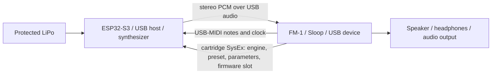

# FM1 Cartridge — Clipper, Melodee and Felucca on an ESP32-S3

A cartridge with an **ESP32-S3 and its own LiPo** for the M-VAVE FM-1 running Sloop. The ESP32 is
the USB host: it receives notes, clock and transport from the FM-1 over USB-MIDI, renders one of three ported
synthesizers (Clipper, Melodee or Felucca) and sends stereo PCM back over USB audio, which the
FM-1 mixes into its own output. The cartridge has no DAC. The three synthesizers live in three
flash slots, and the FM-1 chooses which one runs from its GLO → CARTRIDGE page.



## Status

**Experimental.** The software side builds and passes its native tests; the hardware is a
bench prototype (an ESP32-S3 Super Mini with 4 MB of flash and 2 MB of quad PSRAM, on a protected
1S LiPo).

Observed on hardware: the modified Sloop enumerates on a computer as a stereo 44.1 kHz USB audio
output and plays a tone from it through the FM-1 speaker; the ESP32 plays a tone and Clipper notes
through the FM-1 with a clean sound; the MIDI channel filter keeps the FM-1's other tracks on
their internal sound; the CARTRIDGE page shows its handshake with the ESP32; the three firmware
slots and the matching Sloop install on the hardware and read back identical.

Not yet verified on hardware: booting and switching the three slots, Melodee and Felucca by ear,
the four CARTRIDGE knobs end to end, the cartridge track (sequencer, arpeggiator and takes over
MIDI, PRESETS browsing), long-session stability, latency, the render cost of each
engine on the ESP32, and the power path (gate G0). The gates and their criteria are in
[ROADMAP.md](docs/ROADMAP.md).

## Safety and risks

> **Read this before building or connecting anything.** The cartridge is an experimental
> prototype: hobby modules, a lithium cell and a USB connection outside the Type-C power policy,
> attached to a commercial instrument whose firmware is replaced. A mistake can damage the FM-1,
> the ESP32-S3 board, a computer's USB port or the cell, and a damaged lithium cell can vent or
> catch fire. Everything here comes without any warranty (GPL-3.0, sections 15 and 16); build and
> use it at your own risk.

- **The cell.** Use a protected 1S LiPo, check its polarity with a multimeter, insulate every
  joint, and never crush, puncture, heat or charge it unattended.
- **Power sources.** Never connect the cartridge to a computer or a charger while it is plugged
  into the FM-1, and connect nothing but the cell and its switch to the board's power pads.
- **The USB link.** Both boards present themselves as USB sinks; the link works outside the
  Type-C policy and depends on the cable, orientation and order. No hubs, chargers or other
  devices in between.
- **The FM-1.** Its firmware is replaced by a modified Sloop, which can hold the FM-1's charger off
  through a register bit whose effect is not measured. Back up the FM-1 first; the vendor's
  firmware can be put back.
- **Low cell.** On the prototype, a partly discharged cell takes the ESP32-S3 below its minimum
  supply voltage.
- **Volume.** A fault can produce full-scale noise: start with the FM-1's volume low.

Details: [electrical risks](hardware/README.md#risks-of-electrical-damage) and
[firmware and flashing risks](firmware/README.md#risks).

## What is included

- **Three synthesizers**, each the real upstream DSP compiled as one translation unit behind a
  common interface (`synth/fm1_synth.h`): Clipper 1.3 (23 engines), Felucca 1.7.0 (13 engines) and
  Melodee 1.5.1 (Prophet, FM6, CZ-1, SID, DRUM). Pinned upstream subsets, generated tables,
  licences and SHA-256 manifests in [third_party/](third_party/); scope and limits in
  [PORTS.md](docs/PORTS.md).
- **ESP-IDF firmware** ([firmware/](firmware/README.md)): USB-MIDI host, UAC1 audio out, one
  profile per synthesizer, a three-slot partition table with bootloader rollback, and the
  cartridge server. UART console; the USB port is reserved for the FM-1.
- **Firmware slots** ([FIRMWARE_SLOTS.md](docs/FIRMWARE_SLOTS.md)): the FM-1 picks the slot to
  boot from the FIRMWARE parameter; a slot that never talks to the FM-1 rolls back.
- **Sloop for the FM-1** ([sloop-fm1/](sloop-fm1/)): Sloop 2.8.4 with USB audio playback into
  the mixer (ring buffer and adaptive resampling), the **USB RETURN** gain, the CARTRIDGE page
  and a charger control; one reproducible patch against upstream in
  [integrations/sloop-fm1/](integrations/sloop-fm1/README.md).
- **CARTRIDGE** ([CARTRIDGE.md](docs/CARTRIDGE.md)): engine, preset, parameter and value on the
  FM-1's four knobs, the running firmware's name in the header and the slot selection, over a
  private SysEx protocol confirmed by the ESP32.
- **Cartridge track** ([CARTRIDGE.md](docs/CARTRIDGE.md#the-cartridge-track)): the Sloop track on
  the cartridge's MIDI channel plays the cartridge from its keys, sequencer, arpeggiator and takes,
  shows the cartridge's names and browses its presets with PRESETS.
- **Cartridge manager** ([WEB_MANAGER.md](docs/WEB_MANAGER.md)): a browser page
  (`python3 tools/cartridge_web.py --open`, Chrome or Edge) that reads the cartridge's slots, backs
  up its flash, writes any build or image into any slot, installs Sloop on the FM-1, keeps the
  catalogue of ported and candidate synthesizers and checks every pinned upstream for new
  releases. Adding another synthesizer to a slot follows [PORTING.md](docs/PORTING.md).
- **Simulator and tests**: a native simulator with the same DSP and MIDI parser (one executable
  per synthesizer) writing WAV and JSON, with packet loss, reconnection and clock mismatch; CTest
  suites with sanitizers; CI workflows.

## Using it on the FM-1

1. Power the cartridge from its battery and connect its USB to the FM-1, switched on.
2. Hold **HOME**, select the **USB** section and set **USB RETURN** to 100%; leave the menu.
   Keep the speaker volume low but audible.
3. Select track 1. Once the cartridge answers, the track on the cartridge's MIDI channel
   (channel 1 by default, under **GLO → MIDI**) is the **cartridge track**: its footer, TRACKS
   and the PRESETS page show the cartridge's engine and preset, and its internal engine stays
   silent.
4. Play. The keys, chords, arpeggiator, steps, rolls and recorded takes of the cartridge track
   play the cartridge over MIDI, with **GLO → SYSTEM → OUT** left at KEYS.
5. Turn **PRESETS** on HOME, TRACKS or the PRESETS page to step through the cartridge's presets;
   past the last preset of an engine it goes on into the next engine.

Tap GLO and turn SELECT to **CARTRIDGE**: knobs 1 and 2 choose engine and preset, 3 a parameter
and 4 its value. The header shows the running firmware (**CLIPPER OK**, **MELODEE OK**,
**FELUCCA OK**) or NO LINK. To switch synthesizer, stop the transport, turn knob 3 to
**FIRMWARE** and knob 4 to a slot: the cartridge reboots into it 2 s later. Each firmware keeps
its sound, MIDI channel and edits on the cartridge.

The [user guide](docs/USER_GUIDE.md) walks through every step, from connecting the cartridge to
switching firmware, with a troubleshooting table.

## Build and test on a Mac or Linux

Requirements: a C11 compiler, CMake 3.20 or newer and Python 3. The native build downloads
nothing; the sources and tables of the three synthesizers are included.

```sh
cmake -S . -B build -DCMAKE_BUILD_TYPE=Release
cmake --build build --parallel
ctest --test-dir build --output-on-failure
mkdir -p out
./build/cartridge_sim --seconds 10 --wav out/clipper.wav --report out/clipper.json
./build/cartridge_sim --seconds 10 --faults --wav out/faults.wav --report out/faults.json
./build/cartridge_sim_melodee --seconds 10 --engine 1 --wav out/melodee-fm6.wav --report out/melodee.json
./build/cartridge_sim_felucca --seconds 10 --engine 4 --wav out/felucca-sample.wav --report out/felucca.json
```

The WAV plays with `afplay out/clipper.wav` on macOS. The reports measure simulated logic, not
the hardware's latency, CPU, power or electrical quality. Options in
[SIMULATION.md](docs/SIMULATION.md).

```sh
cmake -S . -B build-sanitize -DCMAKE_BUILD_TYPE=Debug -DFM1_SANITIZE=ON
cmake --build build-sanitize --parallel
ctest --test-dir build-sanitize --output-on-failure
```

The upstream DSPs use fixed-point arithmetic with signed wrap and shifts: their targets build
with `-fwrapv` and two specific UBSan exclusions, while the new modules keep full
instrumentation. See [VALIDATION.md](docs/VALIDATION.md).

The ESP32 firmware builds with ESP-IDF 5.3.6 ([firmware/README.md](firmware/README.md)); the Sloop
package builds with Docker and the JieLi toolchain
([integrations/sloop-fm1/](integrations/sloop-fm1/README.md)). Flashing both devices, with
backups, is described in [FLASHING.md](docs/FLASHING.md); the cartridge manager does the same from
the browser ([WEB_MANAGER.md](docs/WEB_MANAGER.md)).

## Bench order

1. **G0:** Sloop on a computer with VBUS isolated and its own power; decides whether an extra
   VBUS circuit is needed.
2. **G1:** the ESP32 receives notes and clock from Sloop, with UART logs.
3. **G2:** the playback in Sloop, with a tone from a computer through the FM-1 mixer.
4. **G3:** the ESP32 sends a UAC tone to Sloop; continuity and latency.
5. **G4:** each synthesizer on the ESP32: CPU and memory, MIDI and audio together.
6. **G5:** the CARTRIDGE page, its knobs and the firmware slots on hardware.
7. **G6:** LiPo, switch, connector and case after the measurements.

Software tests move the implementation forward but do not replace this sequence. Physical results
go into [BENCH_TESTS.md](docs/BENCH_TESTS.md).

## Hardware and limits

The prototype is an ESP32-S3 Super Mini on a protected 1S LiPo, with an SPDT switch on BAT+,
insulation and a small case, plugged into the FM-1 through a USB-C male-to-male adapter
([BOM, photos and power notes](hardware/README.md)). The cartridge has no step-up converter and
puts no 5 V on VBUS; each side runs from its own battery and the link uses data and ground. That
connection is not a universal Type-C host port.

The ports keep 44.1 kHz, one stereo output and each upstream engine's voices (8 shared voices in
Clipper and Felucca; in Melodee, the single-core budget: a 5-voice Prophet and a 16-voice FM6).
They play one part of each instrument and do not port the original UIs, user presets, editors,
Program Change or CC20/MORPH. The build sets a firmware's first sound; the CARTRIDGE page edits it
live and the cartridge keeps it.

## Not yet understood

Parts of the electrical design are still open, so no circuit here is a proven design
([full table](hardware/README.md#open-questions-in-the-circuit)):

- the prototype board's model, revision and schematic;
- what holds the connector's VBUS at the 3V3 level, and how much current that path can carry;
- the regulator's dropout point, the battery current and its peaks;
- the Type-C role behaviour across cables, orientations and connection orders;
- how the FM-1 detects and loads the cartridge's weak VBUS, and the real effect of the FM-1
  charger bit the cartridge Sloop writes.

## Future work

- **Hardware:** a dedicated board with a proper USB-C source port, a VBUS load switch and a power
  path without back-feed; battery monitoring with a low-battery shutdown; a regulator that keeps
  3V3 in specification over the whole cell range; a tested enclosure
  ([hardware](hardware/README.md#future-hardware-work)).
- **ESP32 firmware:** measured voice limits per engine, user presets, MIDI CC and Program
  Change, several parts on different channels, slot updates over the cartridge link
  ([firmware](firmware/README.md#future-firmware-work)).
- **Sloop:** HOME knobs mapped to cartridge parameters on the cartridge track, the track's PAN on
  the return, the cartridge's sound saved with a project, and the cartridge's battery level on the
  FM-1.

## Repository map

| Folder | Contents |
| --- | --- |
| `firmware/` | ESP-IDF project: MIDI/tone/Clipper/Felucca/Melodee profiles, three-slot partition table, slot flashing script |
| `synth/` | The `fm1_synth.h` interface, the three adapters and the cartridge server |
| `third_party/` | Pinned upstream subsets of Clipper, Felucca and Melodee, generated tables, licences, SHA-256 manifests |
| `sloop-fm1/` | FM-1 firmware: Sloop 2.8.4 with the cartridge profile |
| `integrations/sloop-fm1/` | The Sloop patch against upstream, its manifest and how to reproduce it |
| `core/` | USB-MIDI parser, endpoint discovery, the cartridge wire format and a reference audio receiver |
| `web/` | The cartridge manager (slots, synth catalogue, updates, Sloop install), served by `tools/cartridge_web.py` |
| `sim/`, `tests/` | Offline simulation and tests |
| `hardware/` | BOM, photos of the prototype, and electrical and mechanical notes |
| `docs/` | User guide, architecture, protocols, ports, porting, slots, flashing, the manager, bench tests, gates and validation |

Code under [GPL-3.0-only](LICENSE), preserving the notices and compatible licences of the upstream
components (see each `third_party/*/README.md`). An independent project, not affiliated with
M-VAVE, Seeed or the authors of the original firmwares.
