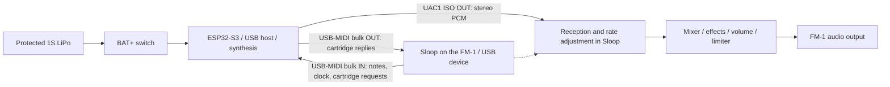

# FM1 cartridge architecture

Design: **the ESP32-S3 is the USB host and the synthesizer; the FM-1 running Sloop is the USB device, the sequencer and the audio output.** The cartridge's own battery powers the ESP32-S3. The cartridge's audio returns to the FM-1 over USB and leaves through the FM-1's audio path. The cartridge has no DAC.

IN/OUT are always relative to the USB host. So MIDI IN leaves the FM-1; audio OUT enters the FM-1. Sloop's optional UAC capture is audio IN for a host, and is not the return path described here.

## Why this topology

- **The FM-1 is a USB device.** Its official firmware and Sloop drive the JieLi AC79/WL82 USB0 controller as a device only, and Sloop already sends keyboard notes and the clock over USB-MIDI (the sequencer, arpeggiator and rolls too with GLO → SYSTEM → OUT = SEQ; the cartridge track sends them with OUT at KEYS). Keeping the FM-1 as the device needs no host stack on it, whose application image has little free flash (1,612 B with the cartridge profile). Sloop only gains a UAC1 playback interface (ISO OUT 0x04), its receiver, the CARTRIDGE page and the cartridge track.
- **The ESP32-S3 is the host.** It has native USB OTG (GPIO19 = D−, GPIO20 = D+), the ESP-IDF USB Host Library and a UAC host component (`espressif/usb_host_uac` 1.5.0) that transmits audio. Its 240 MHz cores, internal SRAM and PSRAM leave far more room for DSP than the FM-1, which keeps running its own instruments.
- **The audio returns over USB into Sloop's mixer.** The FM-1 has no analog audio input, so the return is digital: the same USB connection carries MIDI and PCM, and the cartridge's stereo signal is summed in Sloop's mixer before the global effects, master and limiter, then leaves through the FM-1's own output and speaker. The cartridge needs no DAC and no audio connector.
- **Bandwidth is not the constraint.** The payload at 44.1 kHz is `44,100 samples/s × 2 channels × 2 bytes = 176,400 bytes/s = 1.4112 Mbit/s`, well below the raw 12 Mbit/s of USB full speed even with protocol overhead; MIDI traffic is small by comparison. The constraints are servicing one isochronous packet every 1 ms and the drift between two independent clocks (below).

## Power

The cartridge runs on its own protected 1S LiPo (switch on BAT+) and the FM-1 on its own battery. Neither side supplies 5 V on VBUS: the FM-1's USB-C port is a sink (an Rd pair on CC, and a VBUS path that only feeds its charger, as inferred from board photos), and the cartridge has no boost converter. The data link uses D+/D−/GND. On the device side the FM-1's controller does not depend on VBUS at the connector: in the AC79/WL82 USB0, "VBUS valid" is a register bit that firmware writes, and Sloop sets it itself.

Measured on the Super Mini prototype, through a USB-C male-to-male adapter and with the cartridge on battery: the VBUS seen by the FM-1 follows the cartridge's 3V3 rail (about 2.8 V to 3.3 V, depending on the cell) and is never 5 V; the FM-1 works normally and cannot charge through that path ([hardware](../hardware/README.md)). Two sinks connected Rd–Rd are outside the normal Type-C connection and power policy: this is a controlled experiment, not a universal Type-C host port. Sloop's **CHARGE** control (HOME → USB) holds the FM-1's internal charger off while the cartridge answers, so that the cartridge's cell cannot charge the FM-1's battery if VBUS is ever powered; that control is not yet tested on the SoC. Gate G0 settles the VBUS path ([roadmap](ROADMAP.md)).

## What runs on each side

The adapters in `synth/` run the real DSP of three synthesizers at 44.1 kHz behind one interface, `synth/fm1_synth.h`: Clipper (23 engines, 407 factory presets), Felucca 1.6.1 (13 engines, 72 presets) and Melodee 1.4.5 (5 engines, 327 presets). The same interface serves the cartridge server (`synth/cartridge_remote.c`), the ESP32 audio task, the native simulator and the tests ([PORTS.md](PORTS.md)).

The ESP-IDF 5.3.6 firmware builds one profile per synthesizer, plus a `midi` profile (the default, no audio) and a `tone` profile (a 440 Hz test tone over UAC); the `-4m2m` variants target the Super Mini prototype ([firmware](../firmware/README.md)). The flash holds **three firmware slots** (`ota_0..ota_2`, 1.25 MB each) with Clipper, Melodee and Felucca; the FM-1 chooses which one boots, and the bootloader rolls back a slot that never talks to the FM-1 ([FIRMWARE_SLOTS.md](FIRMWARE_SLOTS.md)).

On the FM-1, the **GLO → CARTRIDGE** page edits the running synthesizer with the four knobs (engine, factory preset, parameter, value), sets its MIDI channel and selects the firmware slot. It speaks the cartridge protocol, version 3, as SysEx over the same USB-MIDI interface; edits stay in the ESP32's RAM ([CARTRIDGE.md](CARTRIDGE.md)). The Sloop track on the cartridge's MIDI channel becomes the cartridge track: its keys, sequencer, arpeggiator and takes reach the cartridge as MIDI notes while its internal engine stays silent, it shows the cartridge's engine and preset, and PRESETS browses the cartridge's presets. The modified Sloop lives in `sloop-fm1/` ([Sloop integration](SLOOP_INTEGRATION.md)).

`sim/main.c` generates WAV/JSON from simulated USB-MIDI and PCM, one executable per synthesizer. `core/audio_return.c` is a native reference receiver (ring and clock adaptation, single owner); **it is not the receiver that runs in Sloop**. The native tests cover the protocol, the receiver, each synthesizer and the simulator outputs ([SIMULATION.md](SIMULATION.md), [VALIDATION.md](VALIDATION.md)).

Observed on hardware: the modified Sloop enumerates on a computer as a stereo 44.1 kHz USB audio output and plays its tone through the FM-1 speaker; the FM-1 sends MIDI notes over USB; the ESP32 plays the 440 Hz tone and Clipper notes through the FM-1 with a clean sound; only the track on the cartridge's MIDI channel plays it; the CARTRIDGE page shows CLIPPER OK; the three slots and the matching Sloop are flashed and read back. Not yet verified on hardware: booting and switching the slots and the rollback, Melodee and Felucca by ear, the four CARTRIDGE knobs end to end, long-session stability, latency, the render cost of each engine, USB stereo L/R, the power and VBUS path, battery life and the charger control. A build, a WAV or a single enumeration is a different kind of evidence from a physical run.

## Limits

- One FM-1 connected directly; no hubs and no generic support for USB instruments.
- Notes and transport come from the MIDI Sloop already emits. The FM-1's knobs do not send their movements as CC; they edit the cartridge only on the CARTRIDGE page.
- A single stereo return at 44.1 kHz / 16-bit PCM. One instrument part per synthesizer, answering one MIDI channel; these are not independent audio tracks.
- Edits made from the FM-1 are not persisted; a reboot or a slot switch returns to the build's engine and preset.
- USB-C with the cartridge's own battery and no 5 V on VBUS is a controlled experiment; it does not represent a universal Type-C host port.

## Division of responsibilities

| Part | Responsibility |
| --- | --- |
| ESP32-S3 | Enumerate descriptors; receive and validate USB-MIDI; produce PCM; transmit UAC; serve the cartridge protocol; boot the selected slot and confirm it; drain operations and go silent on disconnection; record metrics |
| Modified Sloop | Expose UAC1 playback; receive ISO OUT; adapt the clocks; mix the return before effects and master; run the CARTRIDGE page and the charger control; recover from failures |
| Computer | Native tests and WAV; reference host to validate playback on Sloop; logs over UART while the ESP32 occupies its USB port |
| Hardware | Independent power supplies; verified data connection; VBUS isolation; mechanical assembly and cell protection |

The ESP32-S3 uses the ESP-IDF USB Host Library with a single installation shared between the MIDI client and the UAC client; the application never claims the same interface twice. `espressif/usb_host_uac` 1.5.0 is the UAC1 transmission driver; the firmware sizes the host's hardware FIFO explicitly so that the 180-byte ISO OUT packets fit ([USB host FIFO](../firmware/README.md#usb-host-fifo)). [Official UAC driver](https://components.espressif.com/components/espressif/usb_host_uac/versions/1.5.0/readme).

## Clocks and real time

The host's USB clock and the FM-1's DAC are independent. A larger ring buffer alone does not solve the drift. The playback endpoint is **adaptive**: the host delivers the nominal rate synchronized to the USB frames (44 or 45 frames per millisecond), and Sloop resamples with a Hermite ASRC controlled by the occupancy of its buffer. An asynchronous endpoint with feedback would be an alternative, requiring another contract and new tests.

USB callbacks only transfer data and update state. Synthesis, extensive logging and allocation never block USB servicing. On the ESP32-S3 the audio task on core 1 renders blocks of 128 frames, a budget of 2,902 µs at 44.1 kHz; the synthesizer profiles build with `-O2`, a 32 KB instruction cache and a 64 KB data cache, keep voices and other hot state in internal RAM and move only large, sequentially accessed buffers to PSRAM ([real-time budget](../firmware/README.md#real-time-budget)). The USB transfers are allocated by the driver itself in appropriate memory.

Sloop's TIMER5 interrupt calls the UAC services during the render to meet the 1 ms intervals; the cartridge profile adds the urgent playback service, so reception does not depend on the main loop alone. See [integration](SLOOP_INTEGRATION.md).

## Main open risks

- **Power and VBUS (G0).** The Rd–Rd connection is outside the normal Type-C policy, the VBUS path with the cartridge attached is not settled, and the charger control is untested on the SoC.
- **Real time on the ESP32 (G4).** The render cost of each engine (`render_max_us`) is not measured; Melodee is the heaviest in CPU and RAM (229 KB of 341 KB of internal RAM).
- **Clocks and latency (G2/G3).** The ASRC's cost and quality on the FM-1, the one-way latency and long-session stability are not measured.
- **Sloop's flash headroom.** The cartridge profile leaves 1,612 B free in the application image.
- **Firmware slots (G5).** Booting, switching and rollback are verified in software only.
- **Battery and mechanics (G6).** Battery life, peak current and the strain of the cartridge on the FM-1's port are not measured.

## Completion criterion

The product is validated only when it meets the gates of the [roadmap](ROADMAP.md), with hardware results recorded in the [bench tests](BENCH_TESTS.md). Compiling, generating a WAV or enumerating once does not prove continuous audio, battery life, latency, charging or mechanical durability.
