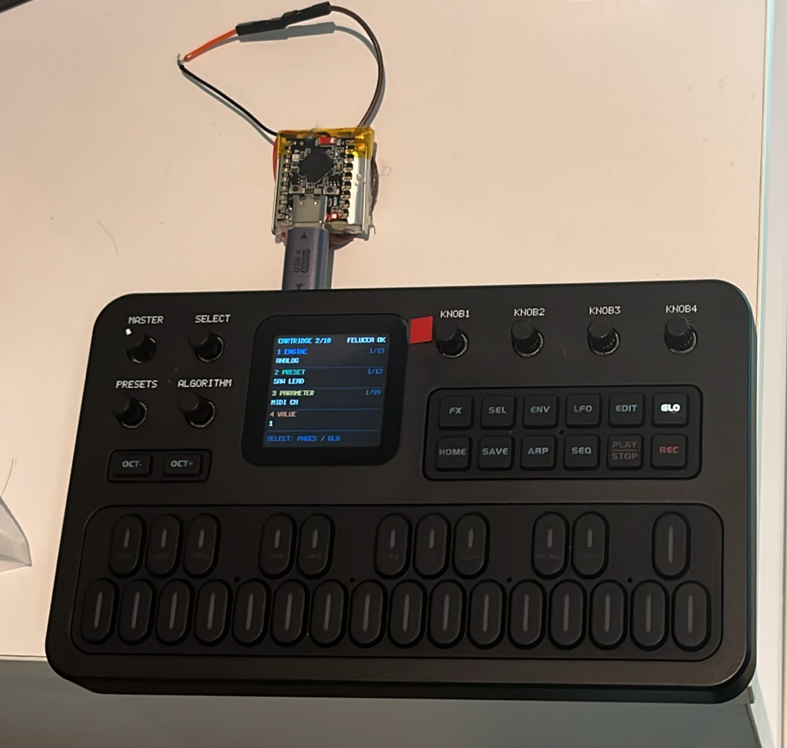
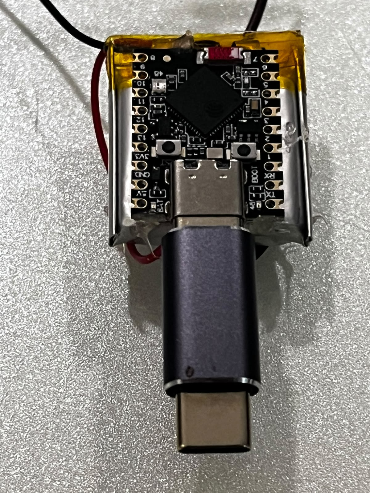

# Hardware and power: experimental prototype

The prototype is an ESP32-S3 Super Mini on a protected 1S LiPo pouch cell, with an SPDT switch on
BAT+, insulation and a small case, plugged into the FM-1 through a USB-C male-to-male adapter. The
[BOM](bom.csv) lists exactly these parts and the multimeter that checks them. The cartridge has
no step-up converter and puts no 5 V on VBUS. Battery life and peak current are not measured.

## Risks of electrical damage

> **Warning.** The cartridge is an experimental prototype built from hobby modules and a lithium
> cell, connected to a commercial instrument in a way the USB Type-C specification does not
> foresee. A wiring mistake can damage the FM-1, the ESP32-S3 board, a computer's USB port or the
> cell, and a damaged lithium cell can vent or catch fire. Build and connect it only if you accept
> that risk. The project comes without any warranty (GPL-3.0, sections 15 and 16).

- **The LiPo cell.** Use only a protected 1S cell. A short circuit, reversed polarity, puncture,
  crushing or heat can make it vent or burn. Check the polarity with a multimeter before the first
  connection, insulate every joint, never charge a swollen or unattended cell, and keep the board's
  charge current within the cell's rating.
- **A second source.** Never connect the board to a computer or a charger while it is plugged
  into the FM-1, and connect nothing but the cell and the switch to its 5V, 3V3 and BAT pads.
  Back-feed can damage a computer's port, the board's charging path or the FM-1.
- **The unidentified VBUS path.** On the Super Mini prototype the connector's VBUS follows the 3V3
  rail through a path that is not identified (table below). Do not draw current from it or feed
  anything into it.
- **The Rd–Rd connection.** Both boards present themselves as USB sinks; the link works by forcing
  the controllers' roles, outside the Type-C power policy. Its behaviour depends on the cable, the
  orientation and the connection order. Do not put hubs, chargers or other devices in the chain.
- **Undervoltage.** With a partly discharged cell the prototype's 3V3 rail falls below the
  ESP32-S3's 3.0 V minimum. Below it the chip runs out of specification and brownout resets can
  stop the audio or a slot switch at any moment.
- **The FM-1's charger.** The cartridge Sloop can hold the FM-1's internal charger off
  (HOME → USB → CHARGE). That control comes from an SDK header and is not measured on the device
  ([firmware risks](../firmware/README.md#risks)).
- **Mechanical strain.** A board, a cell and a case hanging from the FM-1's USB-C port on a rigid
  adapter can break the port or its solder joints. Do not press on the cartridge or carry the FM-1
  by it.
- **Heat.** Current and temperature under load are not measured. Do not close an enclosure around
  the cell before gate G6.

## Prototype board

The prototype is a board marked **ESP32-S3 Super Mini**: ESP32-S3 QFN56 rev v0.2 with in-package XMC flash of 4 MB and AP PSRAM of 2 MB at 3.3 V. It runs the `-4m2m` firmware profiles ([firmware](../firmware/README.md); flashing in [FLASHING.md](../docs/FLASHING.md)). Its commercial model and circuit revision are not confirmed, and no schematic is available; the notes below come from its silkscreen and from measurements.



*The prototype on the FM-1. The ESP32-S3 Super Mini sits on its LiPo pouch cell and plugs straight
into the FM-1's USB-C port through a rigid USB-C male-to-male adapter. The FM-1 shows the
CARTRIDGE page linked to the cartridge (FELUCCA OK), with the ANALOG engine, the SAW LEAD preset
and the MIDI CH parameter on the first three knobs.*



*The Super Mini on the cell, seen from the USB-C end: the BOOT button, the 5V, GND, 3V3 and BAT
pads and the RX/TX pins sit around the connector, and the cell's leads leave from the top.*

This is a bench assembly, not a finished cartridge. With the rigid adapter, the weight of the board
and the cell rests on the FM-1's port ([Mechanics](#mechanics)).

The firmware's plain profiles also target boards with 8 MB of flash and 8 MB of octal PSRAM, such
as the Seeed XIAO ESP32-S3. No such board is built or tested here.

## Operation without VBUS

Measured on the Super Mini prototype, through the USB-C male-to-male adapter and with the cartridge on battery: the VBUS seen by the FM-1 follows the cartridge's 3V3 rail (~2.8 V with the cell at 3.56 V; 3.3 V with the cell at 4.2 V) and is never 5 V. The FM-1 works normally and cannot charge through that path. The 3V3 rail measures 2.77 V with the cell at 3.56 V and 3.3 V with the cell at 4.2 V: the regulator drops out with a low cell, which narrows the usable range of the LiPo (G6 measures the cutoff point). Do not assume isolation between VBUS and 3V3. Measurements in [BENCH_TESTS.md](../docs/BENCH_TESTS.md#g0-measurements-on-the-super-mini-prototype).

The FM-1 stays powered by its own battery and the link uses only D+, D− and GND. The repeatable
test of that link from a computer with VBUS interrupted is gate
[G0](../docs/BENCH_TESTS.md#g0-sloop-on-the-mac-without-vbus), still pending.

A USB-C connection between boards that both advertise themselves as sinks (`Rd` on both sides) does not constitute a normal Type-C DFP/UFP connection. Even if USB 2.0 works by forcing the controller's roles, **this is experimental operation outside the normal Type-C connection/power policy**, dependent on the circuit, cable, orientation and sequence. Do not promise compatibility with any cable, hub or device. The project is not a charger or a generic USB host.

For a product with a compliant Type-C port, design coherent CC/DFP and VBUS switching instead of simply placing Rp over the existing Rd. Keep that redesign separate from the data test. The host firmware does not change the board's resistors. The interpretation that Rd–Rd is not the normal host/device connection follows from the Source/Sink states and the terminations described by the [USB Type-C specification, revision 2.0](https://www.usb.org/sites/default/files/USB%20Type-C%20Spec%20R2.0%20-%20August%202019.pdf); the revision applicable to the final product must be confirmed during its electrical design.

## Battery and switch

```text
Protected LiPo + ── switch (COM ↔ one contact) ── BAT pad (Super Mini)
Protected LiPo − ──────────────────────────────── GND pad (Super Mini)
                          other contact: isolated
```

Confirm polarity by the marked pads and a multimeter; colors and connectors are no guarantee. The cell's protection and discharge capability must cover the measured peaks of the ESP32. Insulate the solder joints, secure the wires without mechanical strain and leave clearance for the cell; do not press, puncture or heat the LiPo when closing the enclosure.

The switch on BAT+ disconnects the cell from the board. USB can still power the board with the
switch open.

Charge the cell outside the FM-1; the FM-1 delivers no 5 V. Whether the Super Mini charges the cell
through its own USB-C port, and at what current, depends on its unconfirmed circuit: measure the
charge current against the cell's datasheet before relying on it, or charge the cell with a
charger that matches its rating. The board gives the firmware no battery reading.

## Debug and flashing

Flash the firmware through the board's own USB-C port, with the board unplugged from the FM-1
([FLASHING.md](../docs/FLASHING.md)). While the firmware runs, that port belongs to the FM-1, so
there is no USB console. The firmware also writes logs to the pins marked TX (GPIO43) and RX
(GPIO44) at 3.3 V; reading them needs a 3.3 V UART adapter on TX, RX and GND only. The prototype
does not use one.

## No 5 V on VBUS

The cartridge needs no step-up converter: the FM-1 runs from its own battery and the link works on
data and ground alone. Do not add a 5 V source on VBUS to this build. It would also feed the FM-1's
charger and the board's own charging path, with back-feed paths through both. A powered VBUS
belongs to a proper USB-C source design (a CC controller, a load switch with current limit and
reverse blocking), listed under [future hardware work](#future-hardware-work).

## Mechanics

The cartridge plugs into the FM-1 through a rigid USB-C male-to-male adapter. Check the adapter's
data continuity in both orientations and how firmly it holds. The weight of the board, the cell and
the case must not lever on the FM-1's connector. Keep access to the switch, to the board's USB-C
port for flashing and to the cell for inspection. Approve the case only after current and
temperature tests and repeated connection cycles.

## Open questions in the circuit

These points of the electrical design are not fully understood. Each one holds back a gate of the
[roadmap](../docs/ROADMAP.md); treat every assumption below as unproven until it is measured.

| Open point | What is known | What settles it |
| --- | --- | --- |
| The Super Mini's circuit | Commercial model and circuit revision unconfirmed; no schematic. Whether and how it charges the cell is unknown. | Identify the board and obtain or trace its schematic. |
| What holds VBUS at the 3V3 level | The connector's VBUS reads 2.77–3.3 V and tracks 3V3, with or without the FM-1: leakage through the regulator, a pull-up or another path. | Trace the path and measure how much current it can carry. |
| Regulator dropout and the practical cutoff | 3V3 is 3.3 V with the cell at 4.2 V and 2.77 V at 3.56 V; it crosses 3.0 V somewhere in between. | G6: measure the crossing under synthesis load. |
| Battery current and peaks | Not measured. | An ammeter in series on BAT+ during synthesis and USB traffic. |
| Type-C roles | Rd on both sides. G0 with VBUS interrupted on a computer is pending; the dependence on cable, orientation and order is not characterised. | The G0 cycles; for a product, a source (DFP) design with a CC controller. |
| The FM-1 side of VBUS | The measured VBUS stays below the FM-1's battery, so no charge flows into it. How the FM-1 detects and loads a 2.8–3.3 V VBUS is not known, and the current into its VBUS pin is not measured. | Current and voltage measurements on the FM-1 side. |
| The FM-1's charger control | The bit (`P3_CHG_CON0` bit 0) comes only from the SDK header. Its effect on charge current, VBUS detection and the power switch's domain is not measured. | An ammeter on the FM-1's battery or VBUS with CHARGE at AUTO and at ON. |
| Charge current of the board | Not confirmed against the cell's limit. | A measurement with the board on USB and the cell connected. |

## Future hardware work

- A dedicated cartridge board: an ESP32-S3 module, a USB-C port with a CC controller acting as a
  proper source, a VBUS load switch with current limit and reverse blocking, and a power path that
  cannot back-feed the charger.
- Battery monitoring: a divider to an ADC pin, a low-battery shutdown above the regulator's
  dropout, and the level shown on the FM-1's CARTRIDGE page through the cartridge protocol.
- A low-dropout or buck-boost regulator, so the cell's whole range keeps 3V3 within specification.
- A charge indicator and a charge current matched to the chosen cell.
- An enclosure with strain relief, tested over connection cycles, that does not lever on the
  FM-1's port.
- A bench fixture with series ammeters and a VBUS breakout, for repeatable measurements.
